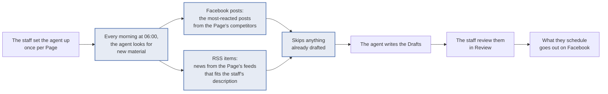

# Auto-drafts

| | |
| --- | --- |
| **Date** | 12 Oct 2026 |
| **Rate** | $300 (see Rate) |
| **Delivery** | 2 weeks after approval: live after week 1, refined by the end of week 2 |

## Summary

Today the staff start every Draft by hand: they pick a post or a news item and ask for a Draft. With this feature, the agent takes over that step. Each morning the agent writes a set number of Drafts for every Page switched on, from your competitors' best Facebook posts and from the Page's RSS feeds. When the working day starts, Review already holds Drafts for the staff to edit and schedule.

Nothing is published without the staff. Auto-drafts only fills Review; scheduling stays their decision.

## How the agent works

The staff set the agent up once per Page. After that, the agent runs on its own every morning.

The highlighted steps are the core development in this feature.

### Step by step

1. **Set up.** On Settings, under **Auto-drafts**, tick **Facebook posts per day**, **RSS items per day**, or both, and set how many Drafts each should write.
2. **Choose the pictures.** Each source has its own **Picture** setting: Google image, Generate with AI or No picture. RSS also offers Source photo, the feed's own picture.
3. **Narrow it down (optional).** Set **Minimum reactions** to skip quieter competitor posts. Describe **Which RSS items to draft** in plain words, for example "UK politics only, no sport or celebrity news". Left blank, the newest items are taken.
4. **The morning run.** At 06:00 Ho Chi Minh City time, the agent writes the Drafts for every Page that has a source switched on. A post or news item is never used twice, even across different Pages.
5. **Review.** The new Drafts appear in Review alongside the ones made by hand, to edit, schedule or reject as usual.
6. **Keep an eye on the agent.** The **Auto-drafts** screen shows every Page on one screen: when the next run is, what each run wrote, and which Pages are running out of material.

### What the Auto-drafts screen shows

| Status | Meaning | What to do |
| --- | --- | --- |
| Ready | More than 5 posts or items left to draft from | Nothing |
| Running low | 5 or fewer left | Tick more competitors, add feeds, or lower the number per day |
| Nothing left | No unused posts or items | As above; the run writes nothing until there is new material |
| OK | The last run wrote every Draft the agent was asked for | Nothing |
| Partial | The agent wrote some, with the reason shown | Usually nothing; check the reason |
| Empty | The agent ran and found nothing to write about | See Running low |
| Failed | No Draft finished | Check the reason, or ask me |

## Included

- The Auto-drafts settings on Settings, per Page and per source
- The daily 06:00 run for every Page with a source switched on
- A post or RSS item is never drafted twice, across all Pages
- A Picture choice per source
- The Auto-drafts screen, with the run history and the statuses above
- A run that finds nothing is still recorded, so "nothing to write about" and "did not run" look different

## Not included

| Item | Reason |
| --- | --- |
| Publishing without review | Every Draft still goes through Review, by design |
| A different run time per Page | One daily time for all Pages. Possible later feature |
| Reusing a competitor's photo | Their picture is not ours to post |
| Other sources, such as web pages or saved posts | Possible later feature |
| Website articles from RSS Drafts | Separate feature |

## Done when

Each item below is checked together during the demo.

- [x] With Facebook posts set to 2, the next morning's run puts 2 new Drafts for that Page in Review
- [x] No two Drafts, on any Page, come from the same post or RSS item
- [x] With Minimum reactions at 500, no Draft comes from a post with fewer than 500 reactions
- [x] With an RSS description set, the Drafts only cover items that fit it
- [x] Each source's Drafts follow its Picture choice: No picture gives none, Source photo gives the feed's own photo
- [x] The Auto-drafts screen shows each Page's material left, its last run and the run history
- [x] A run with nothing left shows as Empty with the reason
- [x] One Page's broken feed does not stop the other Pages' Drafts
- [x] Unticking both sources stops Drafts for that Page
- [x] Existing features work as before, including asking for a Draft by hand

## Rate

| Item | Rate |
| --- | --- |
| Design and build, including the testing and the monitoring week | US$200 |
| Maintenance after delivery | US$100 |
| **Total** | **US$300** |

### Why maintenance is ongoing

The agent reads content from sites and services it does not control, and they change without notice. Automation that reads the web is never finished: it needs regular checks, and the flow is updated when something outside it changes. Typical causes:

- **Sites change their layout.** A news site redesigns its pages, and the agent can no longer find the article text.
- **Sites block automated reading.** Publishers tighten their access rules, add paywalls or cookie walls, or refuse automated visitors outright. Some already do.
- **Feeds move or stop.** An RSS feed changes address or format, or is switched off.
- **New page formats appear.** For example, live blogs had to be skipped because only the first few minutes of a story could be read.
- **Platforms change their rules.** Facebook and Metricool change what competitor data they share, and how.
- **AI models are retired or change behaviour.** Google retires Gemini models, sometimes without warning, and a newer model can write differently.
- **Service limits and prices change.** SerpAPI or Gemini change their free tiers, limits or pricing.

Maintenance covers checking the daily runs, finding these changes, and updating the flow to keep Drafts coming. New sources or settings are quoted as a new feature.

## Running costs

Auto-drafts adds usage to accounts you already pay for. At [N] Drafts a day, expect about **US$[X] per month** in total.

| What | Cost |
| --- | --- |
| Writing each Draft | One AI call, the same as a Draft asked for by hand (Gemini) |
| Choosing RSS items | One extra AI call per Page per day, only when a description is set (Gemini) |
| Source photo, No picture | Free |
| Google image | One image search per Draft (SerpAPI). The free tier covers 250 a month; 20 Drafts a day is about 600 |
| Generate with AI | One paid AI image per Draft (Gemini) |

Pictures are added before the staff review a Draft, so a rejected Draft's picture is still paid for. Source photo and No picture are the cheapest choices for that reason.
